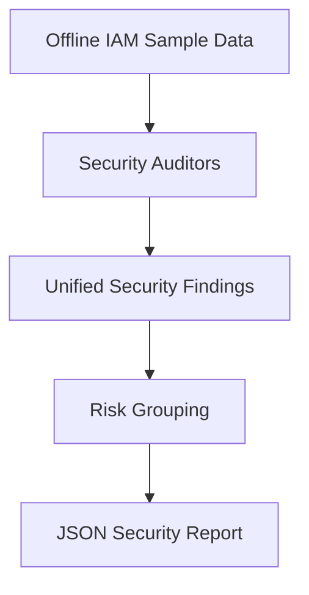

# SentinelCore — AWS IAM Security Hardening & Risk Assessment

SentinelCore is an offline-first AWS Identity and Access Management (IAM) security assessment project built with Python. It analyzes IAM policy documents, role trust policies, and simulated IAM credential reports to identify potential security misconfigurations and privilege-escalation indicators.

The project demonstrates defensive cloud security engineering, IAM risk analysis, detection logic, automated testing, and security reporting.

## Security Capabilities

### 1. IAM Policy Auditing
- Detects broad administrative permissions such as `Action: "*"` and `iam:*`.
- Identifies sensitive IAM actions granted on wildcard resources.
- Highlights overly broad resource permissions.
- Records whether a policy statement contains conditions.

### 2. Privilege-Escalation Risk Detection
- Checks for potentially dangerous IAM operations, including policy attachment, policy version changes, and role passing.
- Expands selected wildcard action patterns to identify risky operations.
- Reports potential escalation paths without claiming confirmed exploitability.

### 3. IAM Role Trust Policy Auditing
- Identifies wildcard principals in Allow-based role assumption policies.
- Distinguishes Allow statements from Deny-only trust statements.

### 4. Credential Security Auditing
- Detects console-enabled IAM users without MFA.
- Identifies active access keys exceeding a configurable age threshold.
- Evaluates both IAM access-key slots.
- Handles UTC timestamp normalization.

### 5. Risk Grouping and Reporting
- Consolidates related detections while retaining original findings.
- Separates risks by policy, role, IAM user, and credential issue.
- Generates JSON reports with severity counts and remediation guidance.

## Architecture



## Technology Stack

- Python
- AWS IAM policy and credential-report formats
- pytest
- JSON and CSV
- boto3 / botocore (declared dependencies; live AWS scanning is not implemented)

## Installation

```bash
git clone https://github.com/Sidbalagopal10/aws-iam-security-hardening.git
cd aws-iam-security-hardening

python3 -m venv .venv
source .venv/bin/activate
python -m pip install -r requirements.txt
```

## Run the Offline Assessment

```bash
python -m src.generate_full_report
```

The generated report is written to:

```text
reports/sentinelcore_full_report.json
```

## Run Automated Tests

```bash
python -m pytest tests/ -q
```

At the time of documentation, the project passed 36 automated tests.

## Example Assessment

The included synthetic dataset produces:

| Metric | Count |
|---|---:|
| IAM policy documents | 1 |
| Role trust policies | 1 |
| IAM users | 3 |
| Raw findings | 10 |
| Grouped risks | 5 |

These numbers represent intentionally vulnerable offline test fixtures, not findings from a live AWS account.

## Security and Scope Limitations

- SentinelCore currently operates on local sample data.
- It does not enumerate live AWS accounts or make IAM changes.
- Findings are heuristic indicators, not confirmed effective permissions or exploitable vulnerabilities.
- It does not comprehensively evaluate explicit Deny interactions, service control policies, permissions boundaries, resource policies, or all IAM condition semantics.
- Selected wildcard patterns are supported; complete IAM policy-language evaluation is outside the current scope.
- Root-account credential controls are excluded from the credential auditor.
- Risk grouping is a reporting heuristic and does not establish a common exploit path.

## Security Practices

- No AWS access keys are required to run the offline assessment.
- No live AWS permissions or paid AWS resources are required.
- Generated reports, local virtual environments, and common credential files are excluded from Git tracking.
- Sample IAM identities and findings are synthetic.

## Project Purpose

SentinelCore was developed as a hands-on cloud security engineering portfolio project focused on identifying and communicating IAM configuration risks using reproducible detection logic and automated validation.
